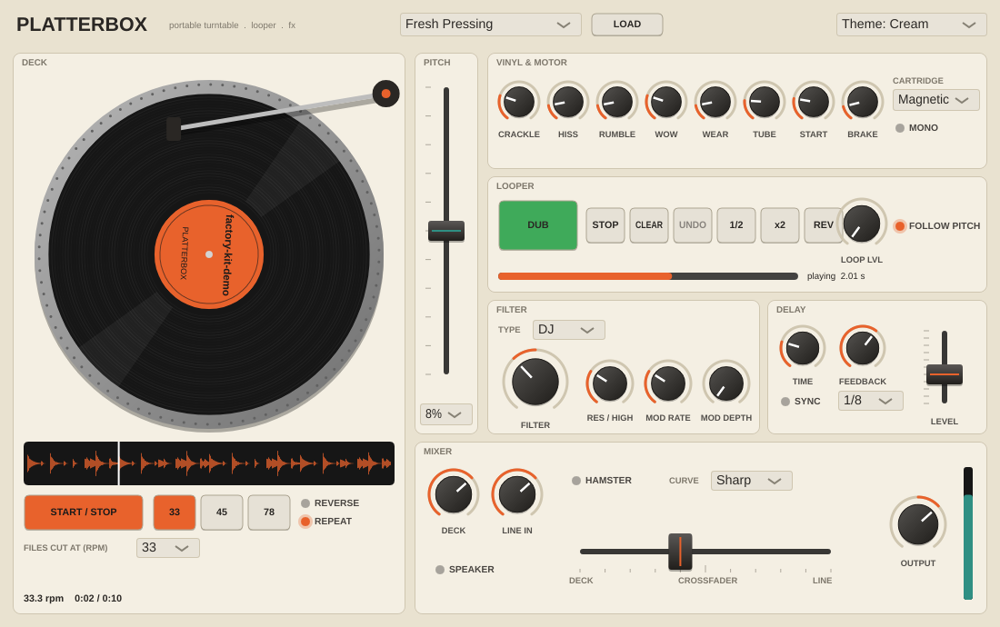

# Platterbox (working name)

A portable-turntable emulator plugin (VST3 + standalone). Load any audio file and it plays as a
record on a belt-drive deck with a looper, DJ/EQ/wah filter, delay, crossfader and a small built-in
speaker, modelled on the feature set of the current wave of portable "play anywhere" record players.
See `docs/DESIGN.md`.



## Build

```
cmake -B build -DCMAKE_BUILD_TYPE=Release            # fetches JUCE 8.0.4
# or: cmake -B build -DJUCE_DIR=/path/to/JUCE
cmake --build build --config Release
ctest --test-dir build                                # engine tests
```

macOS builds target macOS 11+ universal (Intel + Apple Silicon). No AVX2 or other `-march` flags
are used; the DSP is scalar C++. Windows builds use the static runtime.

`-DPLATTERBOX_BUILD_TOOLS=ON` adds `PlatterboxSmoke`, which plays a file through the full processor
with a scripted performance, writes `smoke-render.wav` and renders the UI in every theme to PNG:
`PlatterboxSmoke <audio file> <out dir>` (on headless Linux, run it under `xvfb-run`).

Layout: `Source/engine` is plain C++ (platter and motor, vinyl character, looper, filters, delay,
speaker) with tests in `tests/`. `Source/plugin` is the JUCE wrapper and UI.
